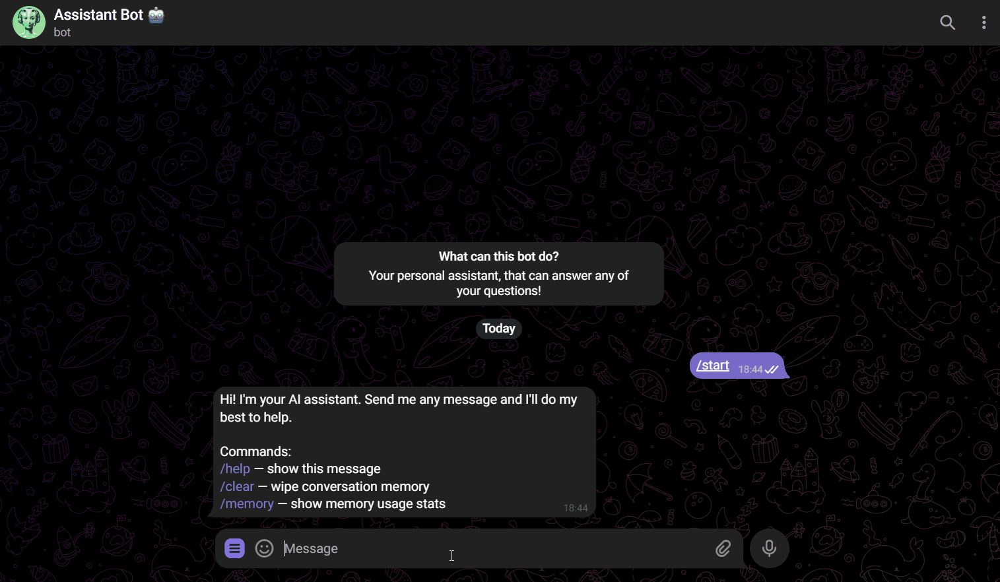

# PaAi (Personal Assistant AI)

> A Telegram chatbot that remembers each conversation and answers both text and voice notes. A separate FastAPI service holds the logic, Claude is the default LLM and ElevenLabs does the voice.

PaAi is an assistant you talk to on Telegram, by text or by voice note. It remembers your conversation across messages and across restarts. The LLM and the voice engine sit behind interfaces, so I can swap them without changes to the chat side.

---

## Demo




*A real conversation where PaAi recalls something I said earlier in the same chat.*

---

## Features

- 💬 **Conversation on Telegram.** It works in private chats and in groups. In a group it only answers when you mention it.
- 🎙️ **Voice notes.** You send a voice note and PaAi replies with a voice note. For a long answer, the voice note is a spoken summary and the full answer follows as text ([details below](#voice-notes)).
- 🧠 **Persistent memory.** PaAi stores each conversation in SQLite, so the memory survives restarts. Each chat has its own memory, and text and voice notes share it.
- 📏 **Token-aware context window.** PaAi sends as much recent history as fits a token budget, and drops the oldest messages first.
- 🔌 **Pluggable backends.** One env var selects the LLM, Claude (cloud, default) or Ollama (local). A second env var turns voice on or off.
- ⚙️ **Configuration in the environment.** There are no secrets in the code.
- 🛡️ **Error handling.** Empty messages and silent voice notes never reach the LLM. When an answer reaches the output limit, the answer says so. When a voice step fails, PaAi replies with text, it does not go silent or crash.
- 🧪 **Tests, evaluations and metrics.** 93 unit and API tests, evaluation suites for text and voice that run against the live models, and metrics for the latency and cost of each voice turn.
- 🤖 **Commands.** `/start`, `/help`, `/clear` (wipes the memory) and `/memory` (shows usage stats).

---

## Voice notes

**What it does:** you send PaAi a voice note on Telegram and it replies with a voice note. When the answer is too long or too detailed to speak, the full answer also comes as text.

**What it does not do:** it is not a live call. PaAi answers each voice note as a whole, so a detailed answer takes about 20 seconds. It does not read long answers or code out loud word by word, the summary model writes a short spoken summary instead. It also answers voice notes only in private chats, because a voice note cannot mention the bot in a group.

**How PaAi handles a voice note:**

```
voice note (Ogg/Opus, as Telegram sends it)
  → speech-to-text       ElevenLabs Scribe v2 reads Ogg/Opus directly, with no conversion
  → chat turn            the same steps as a text message: memory + main model (Claude Sonnet)
  → text to speak:
       short, plain answer  → PaAi speaks the answer, without the Markdown symbols
       long or structured   → the summary model (Claude Haiku) writes a spoken summary,
                              and PaAi also sends the full answer as text
  → safety cap           500 characters, cut at the end of a sentence, never mid-word
  → text-to-speech       ElevenLabs Flash v2.5 writes Ogg/Opus, which Telegram shows as a voice note
```

If a step fails, PaAi replies with text. That covers speech-to-text, silence, the summary model and text-to-speech. Each voice note has a caption with what PaAi heard (`🗣 I heard: …`), so you see a wrong transcript right away.

---

## Architecture

PaAi runs as **two separate processes**, a thin Telegram interface and a FastAPI "brain". The interface knows nothing about LLMs, voice or memory, it only passes messages and voice notes over HTTP. Because of this, the same backend can serve a web UI, a CLI or another front end without changes.

```
┌────────────┐ text / voice ┌──────────────────┐   POST /chat      ┌──────────────────────────────┐
│  Telegram  │─────────────▶│      bot.py      │   POST /voice/chat│       api.py (FastAPI)       │
│   (user)   │◀─────────────│ (python-telegram │──────────────────▶│                              │
└────────────┘ text / voice │  -bot, polling)  │◀──────────────────│  ┌────────────────────────┐  │
                            └──────────────────┘     response      │  │ MemoryManager          │  │
                                                                   │  │ token-aware window     │  │
                                                                   │  └───────────┬────────────┘  │
                                                                   │  ┌───────────▼────────────┐  │
                                                                   │  │ SQLite: conversations  │  │
                                                                   │  │ + messages             │  │
                                                                   │  └────────────────────────┘  │
                                                                   │  ┌─────────────┐┌─────────┐  │
                                                                   │  │ LLMProvider ││  Voice  │  │
                                                                   │  │  (factory)  ││Provider │  │
                                                                   │  └──┬───────┬──┘└────┬────┘  │
                                                                   └─────│───────│────────│───────┘
                                                                         ▼       ▼        ▼
                                                                   ┌──────────┐┌───────┐┌────────────┐
                                                                   │  Claude  ││Ollama ││ ElevenLabs │
                                                                   │ Sonnet + ││(local)││ STT + TTS  │
                                                                   │  Haiku   │└───────┘└────────────┘
                                                                   └──────────┘
```

**Request flow (text):** `bot.py` gets the message and sends it to `POST /chat`. The API saves the message, and `MemoryManager` builds a context window from the history, inside the token budget. The `LLMProvider` writes the answer, and the API saves it and sends it back to the user.

**Request flow (voice):** `bot.py` downloads the voice note and sends it to `POST /voice/chat`. The `VoiceProvider` transcribes it, and the transcript goes through the same chat turn as a text message, so text and voice share the memory. PaAi then prepares the text to speak, and the `VoiceProvider` turns it into audio. The API returns the audio, the transcript, the full answer and the time of each step.

### Project structure

```
01-paai-chatbot/
├── bot.py                  # Telegram interface (polling, commands, voice notes)
├── api.py                  # FastAPI service: /chat, /voice/chat, /memory, /health
├── core/
│   ├── config.py           # Env-based settings (pydantic-settings)
│   ├── llm/
│   │   ├── base.py         # LLMProvider interface + output-limit notice
│   │   ├── claude.py       # Claude implementation (async)
│   │   ├── ollama.py       # Ollama implementation (async)
│   │   └── factory.py      # Main model and summary model, from LLM_PROVIDER
│   ├── memory/
│   │   ├── database.py     # Async SQLite access (aiosqlite)
│   │   └── manager.py      # Token-aware sliding window
│   └── voice/
│       ├── base.py         # VoiceProvider interface + labelled VoiceError
│       ├── elevenlabs.py   # ElevenLabs speech-to-text and text-to-speech
│       ├── null.py         # Voice turned off: fails cleanly
│       ├── speech.py       # Speakable check, Markdown removal, safety cap
│       └── factory.py      # Selects provider from VOICE_PROVIDER
├── prompts/
│   ├── system.txt          # System prompt (editable, not hardcoded)
│   └── voice_summary.txt   # Instructions for the summary model
├── eval/
│   ├── cases.json          # Text behavioural cases
│   ├── run_eval.py         # Text evaluation runner
│   ├── voice_cases.json    # Voice behavioural cases
│   ├── run_voice_eval.py   # Voice evaluation runner (live ElevenLabs + Claude)
│   ├── grading.py          # Pass/fail checks for the eval cases
│   ├── voice_metrics.py    # Makes latency and cost tables from the metrics
│   ├── fixtures/           # Fixed answers for the spoken-summary cases
│   └── audio/              # Audio files for the voice evaluations
├── scripts/
│   ├── list_voices.py      # Which voices your ElevenLabs plan can use
│   └── voice_smoke.py      # One real speech-to-text + text-to-speech call
├── tests/                  # 93 unit and API tests (no API key or network)
├── requirements.txt
└── .env.example            # Configuration template
```

---

## Key decisions and why

**1. Pluggable LLM provider, cloud by default.**
The LLM sits behind an `LLMProvider` interface (`chat()` and `estimate_tokens()`), and a factory picks the implementation from one env var. Claude is the default because it is reliable and needs no local GPU. Ollama is still a full option for local or offline runs. With the interface, the rest of the system never depends on one vendor, and a new provider is one new file.

**2. Token-aware sliding window for memory.**
Memory has a **token budget**, not a fixed number of messages. On each turn the manager walks the history from newest to oldest and adds messages until it reaches the budget, and it always keeps at least the last exchange. This keeps each request inside the model limits and keeps the cost predictable, with as much recent context as possible. A summary of older context would keep more of it for fewer tokens, I left that as a next step (see below).

**3. SQLite persistence, one memory per chat.**
Conversations live in two tables, `conversations` and `messages`, with the Telegram `chat_id` as the key. So the memory survives restarts and each conversation stays separate. I chose SQLite over an in-memory dict, which loses everything on restart, and over a bigger database, which this scale does not need. It is a single file with no setup, and the schema is easy to extend. For example, a `summary` column later needs no rewrite.

**4. The bot and the API are separate.**
With the Telegram interface apart from the FastAPI brain, the AI logic is reusable and easy to test on its own. Real systems separate transport from application logic in the same way.

**5. Configuration and prompts are data, not code.**
All secrets and settings come from the environment (`pydantic-settings`), and the prompts live in `prompts/`. I can change both without touching the code.

**6. Voice uses the same provider pattern, and the API runs the voice pipeline.**
A `VoiceProvider` interface holds speech-to-text and text-to-speech, the same way `LLMProvider` holds the LLM. ElevenLabs is one implementation, and a null provider turns voice off when the configuration has no key. The full voice pipeline runs in one API endpoint and not in the bot. The bot stays a thin relay that knows nothing about speech, and every fallback path is in one place, so tests with fake providers can cover all of them. Each failure gets a label (`auth`, `plan_limit`, `rate_limited`, `timeout`, …), so the logs show why voice failed, and the user always gets a text reply.

**7. Voice notes use a summary model, not structured outputs.**
The first voice version spoke the first 500 characters of the written answer, Markdown headers included. My first fix was structured output for voice turns, one JSON answer with a short `spoken` part and an optional `details` part. But before I built it, I came up with a simpler pipeline:

- The main model (Claude Sonnet) answers exactly as it does for text.
- If the answer is too long or too structured to speak, the summary model (Claude Haiku) writes a spoken summary of a few sentences, and the full answer follows as text. PaAi speaks short, plain answers directly.

With this pipeline, text and voice get the same answers and the same memory. There is no risk of malformed JSON, which is more likely with local models, and the summary model has one narrow job that I can test on its own. The cost is one more call, with a median of **1.7 s**, and only on long answers.

Structured outputs were on the original checklist for this project. They do not fit this design, so I moved them to a later project where the output of the model goes directly into code.

---

## Evaluation

Tests show that the code runs. To check that the answers are good, PaAi has evaluation suites that run against the live models and check each answer for expected and forbidden content.

### Text (`eval/run_eval.py`)

| Case | Category | What it verifies |
|------|----------|------------------|
| `mem-01` | Memory recall | Recalls the user's name from an earlier turn |
| `mem-02` | Memory recall | Recalls a stated preference |
| `err-01` | Error handling | Handles an empty/whitespace message without erroring |
| `honesty-01` | Honesty | Admits a knowable fact rather than hallucinating |
| `scope-01` | Coherence | Stays coherent across a multi-turn technical exchange |

**Latest result: `5/5 passed`.**

### Voice (`eval/run_voice_eval.py`)

| Case | Category | What it verifies |
|------|----------|------------------|
| `voice-stt-01` | Transcription | Transcribes a known recording with its key facts |
| `voice-err-01` | Error handling | A silent voice note never reaches the LLM, and the user gets a friendly reply |
| `voice-rt-01` | Round trip | Converts text to speech and back, and keeps the key words |
| `voice-pt-01` | Multilingual | Does the same in Portuguese, and detects the language as Portuguese |
| `voice-sum-01` | Spoken summary | Turns a long structured answer into a spoken summary: at most 500 characters, a complete last sentence, no Markdown, and a key fact from the answer |
| `voice-sum-02` | Spoken summary | Describes code in words, and never reads code aloud |

**Latest result: `6/6 passed`.** The voice evaluations call the same code the product runs. They use a temporary database, and one run costs about 70 ElevenLabs credits (my estimate from the cost model below). `voice-stt-01` uses a recording of my own voice, which is not in the repository. To run that case, record your own file as `eval/audio/known_phrase.ogg`. Without it, the runner skips the case and never marks it as passed.

### What the checks caught

Some of these checks, and the metrics below, caught real problems:

- **`err-01` caught a real bug.** PaAi sent a whitespace-only message straight to the model, and the model rejects empty content with an HTTP 400. I fixed it with an input guard that handles empty input before any call to the LLM. `voice-err-01` checks the same guard for voice notes.
- **`honesty-01` caught a mistake in my own eval.** The model answered the "population of Mars" question very well ("0, no humans live on Mars"), but the test failed because it wanted all the listed synonyms in the answer. The answer was fine, the check was wrong. So the grader got `expected_any` (at least one match), and since then the grader has its own unit tests.
- **The metrics found a problem I could not hear.** The first spoken summaries sounded natural, but the logs showed that the safety cap cut **2 of 2** of them. The safety cap did the job of the prompt. A length budget in the prompt brought this to 0 of 2, and the summary model got about 30% faster.
- **The metrics found incomplete answers.** In one measured session, **4 of 5** detailed answers stopped at the output limit of the main model (1,024 tokens), in text and in voice, with no sign for the user. An instruction in the system prompt brought it down to 1 of 5. PaAi now detects the last case, the answer ends with *"I ran out of space here — ask me to continue"* and the metrics count it.

You can run them yourself (you need configured providers):

```bash
python eval/run_eval.py          # text
python eval/run_voice_eval.py    # voice
```

---

## Voice performance and cost

I measured real voice turns in October 2026. The samples are small, 3 short turns and 5 long turns, and I measured the long ones after the length fixes above. Times are medians.

| Step | Short answer (spoken directly) | Long answer (spoken summary) |
|------|------|------|
| Speech-to-text | 0.6 s | 0.7 s |
| Main model (Claude Sonnet) | 1.3 s | 17.9 s |
| Summary model (Claude Haiku) | — | 1.7 s |
| Text-to-speech | 0.6 s | 1.0 s |
| **Total** | **3.1 s** | **20.9 s** |

On long answers, the main model takes about 85% of the time and the voice steps only about 3.4 s. So faster voice steps alone do not help much. To make long voice notes faster, PaAi needs streaming, so speech can start before the full answer exists.

**Cost:** almost all of the cost is text-to-speech. My usage matches about **0.5 credits per spoken character**, plus about 1 credit per second of transcribed audio. That is about **160 credits per voice turn** in mixed use, so the free ElevenLabs plan (10,000 credits a month) covers about **60 voice turns a month**. The safety cap and the spoken summaries keep this number predictable.

PaAi writes the metrics of each voice turn to `voice_metrics.jsonl`, only numbers and never transcripts. To build the tables:

```bash
python eval/voice_metrics.py
```

---

## Testing

Unit and API tests need no API key and no network. Fakes replace the LLM, the voice provider and Telegram, and each test uses a temporary database:

```bash
python -m pytest
```

They cover the memory layer, the voice provider, the speech helpers, every fallback path of `/voice/chat`, the Telegram handler for voice notes, the metrics and the grader of the evaluations. Current status: `93/93 passed`.

---

## Setup and running

### Prerequisites
- Python 3.10+ (tested on 3.11 and 3.14)
- A Telegram bot token (from [@BotFather](https://t.me/BotFather))
- An Anthropic API key (from [console.anthropic.com](https://console.anthropic.com)), or a local [Ollama](https://ollama.com) install
- *For voice (optional):* an [ElevenLabs](https://elevenlabs.io) API key. The free plan works with the **premade** voices, library voices need a paid plan when you use the API. Give the key only the permissions PaAi needs: Speech to Text, Text to Speech and Voices (read).
- *For the voice evaluations (optional):* `ffmpeg`. The runner only uses it if the silent audio file is missing.

### 1. Install
```bash
python3 -m venv .venv
source .venv/bin/activate          # Windows: .venv\Scripts\activate
pip install -r requirements.txt
```

### 2. Configure
```bash
cp .env.example .env
```
Edit `.env` and set at least `TELEGRAM_TOKEN`, `BOT_USERNAME` and `CLAUDE_API_KEY`. To run locally, set `LLM_PROVIDER=ollama`.

For voice, also set `ELEVENLABS_API_KEY` and `ELEVENLABS_VOICE_ID`. To find a voice your plan can use:
```bash
python scripts/list_voices.py      # ✓ marks voices usable on the free plan
```
If these values are missing, PaAi turns voice off and voice notes get a text reply. `VOICE_PROVIDER=none` does the same.

### 3. Run (two terminals)
```bash
# Terminal 1: the API
uvicorn api:app --reload

# Terminal 2: the bot
python bot.py
```
Message your bot on Telegram. For example, tell it your name and then ask it to recall the name. Send a voice note, then ask a follow-up question by text. Use `/memory` to see the context usage and `/clear` to reset.

---

## Known limitations and future work

- **Memory is a sliding window, not a summary.** PaAi drops very old context instead of compressing it. *Next step: a running summary of older turns.*
- **Long voice notes take about 20 s.** PaAi answers each voice note as a whole, and the main model uses most of that time. *Next step: streaming, so speech starts before the full answer exists.*
- **Very broad questions can reach the output limit** (1,024 tokens). The answer says so, and when you ask PaAi to continue, it continues from the cut.
- **Text-to-speech reads some symbols literally.** For example, "UTC+1" sounds strange. **The accent comes from the chosen voice**, with my voice Portuguese has a Brazilian accent.
- **PaAi answers voice notes only in private chats**, because a voice note cannot mention the bot in a group.
- **Text messages show raw Markdown** (`**bold**`), because PaAi does not tell Telegram to render it. *Next step: convert answers to Telegram HTML, with plain text as the fallback.*
- **No authentication on the API.** The `/chat` and `/voice/chat` endpoints accept any request and assume a trusted local network. Production needs an API key or a token check.
- **PaAi stores conversations in plaintext.** Each `chat_id` has its own data, but there is no encryption at rest. *Next step: encryption at rest.*
- **Polling, not webhooks.** Polling is fine for development and demos. For production, webhooks are better for latency and scale.

---

## Background and learnings

PaAi is the first project in my move from software developer to **AI Engineer**, which I document in my [learning roadmap](../ROADMAP.md). It started as a chatbot I built during my degree internship (*Estágio*), and I rebuilt it from zero to show the basics of a well-built LLM application: API integration, conversation memory, configuration, error handling and, very important, measuring if the system really works.

A few things I learned from the rebuild:

- **The original had a hardcoded API token, global state shared by all users and an in-memory dict that disappeared on restart.** Fixing these taught me that code that runs and code that is sound are really different things.
- **Evaluation changes how I build.** Writing behaviour tests found a real bug and made me fix my own eval logic. I think this feedback loop is a big part of the job.
- **Prompts ask, code guarantees.** Telling a model "at most 60 words" or "under 500 words" reduced the overruns but never removed them. So each limit on length in PaAi has a prompt for the normal case and code that handles the exception in a visible way, the safety cap and the detection of the output limit.
- **Measure what you cannot hear.** The safety cap cut voice notes that sounded fine on every long answer, and some detailed answers were incomplete without any sign. Only the metrics of each turn showed it.
- **Voice is much simpler now.** In the internship version I used Google speech services through Firebase, and it was a lot of setup. This version needs one scoped API key and a voice ID, behind an interface I can swap.
- **Python moves fast.** Running it on Python 3.14 meant fixing a failed native wheel build (dependencies too old for the interpreter) and two asyncio and `requests` issues from 3.12+. Honestly, this kind of environment debugging never shows up in tutorials.

My goal was never the most advanced chatbot. I wanted an honest, well measured project that shows the core technologies and that people can understand.
